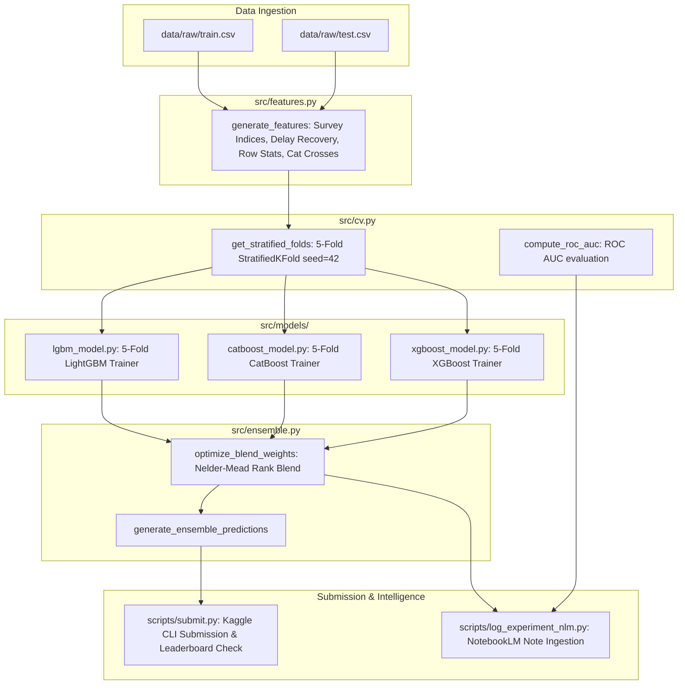

# Kaggle S6E10 Predicting Airline Satisfaction Implementation Plan

> **For agentic workers:** REQUIRED SUB-SKILL: Use superpowers:subagent-driven-development or autonomous orchestrator to implement this plan task-by-task under `/goal`. Steps use checkbox (`- [ ]`) syntax for tracking.

**Goal:** Build and execute an end-to-end competitive ML pipeline for Kaggle Playground Series S6E10 (Predicting Airline Satisfaction), featuring domain feature engineering, Stratified 5-Fold CV, Tri-GBDT modeling (LightGBM, CatBoost, XGBoost), Nelder-Mead rank blending, automated Kaggle CLI submission, and NotebookLM experiment tracking.

**Architecture:** The pipeline ingests raw competition tabular data (`train.csv`, `test.csv`), applies vectorized feature transformations (comfort/digital/service survey indices, delay recovery, row-level rating statistics, categorical crossing), and runs identical Stratified 5-Fold CV across LightGBM, CatBoost, and XGBoost. Out-of-fold probability predictions are normalized via rank averaging, combined using an optimal ROC AUC weight search, verified against sample submission schemas, submitted via Kaggle CLI, and summarized into NotebookLM.

**Architecture Diagram:**



**Tech Stack:** Python 3.12, LightGBM 4.7.0, CatBoost 1.2.10, XGBoost 3.4.1, Scikit-Learn 1.9.1, Polars 2.1.0, Pandas 3.1.0, Kaggle CLI 2.2.5, NotebookLM MCP, Pytest 9.2.0, JudgeGuard.

**Spec:** [docs/superpowers/specs/2026-10-28-airline-satisfaction-pipeline-design.md](file:///home/kizajosmladjibacije/KAggleerko/docs/superpowers/specs/2026-10-28-airline-satisfaction-pipeline-design.md)

## Global Constraints

- Evaluation metric is strictly **ROC AUC** (`sklearn.metrics.roc_auc_score`).
- Target variable is `satisfaction` (binary, mapped to 0 and 1).
- Cross-validation must strictly use `StratifiedKFold(n_splits=5, shuffle=True, random_state=42)`.
- Never fit transformers or statistics across the entire dataset; all target-dependent encoders must be fit inside folds.
- Every critical operation must adhere to `WORK_LOG.md` lifecycle and pass `judge_guard.py` before execution and upon completion.
- Python runtime must use `/home/kizajosmladjibacije/KAggleerko/.venv/bin/python3`.

---

## Task Decomposition

### Task 1: Feature Engineering Engine (`src/features.py`)

**Files:**
- Create: `src/features.py`
- Test: `tests/test_features.py`

**Interfaces:**
- Consumes: Raw pandas/polars DataFrame with standard airline satisfaction columns (`id`, `Gender`, `Customer Type`, `Age`, `Type of Travel`, `Class`, `Flight Distance`, 12 survey ratings, `Departure Delay in Minutes`, `Arrival Delay in Minutes`, optional `satisfaction`).
- Produces: Transformed DataFrame with original features, survey indices (`inflight_comfort_index`, `digital_exp_index`, `service_quality_index`, `ground_service_index`), per-row rating stats (`ratings_sum`, `ratings_mean`, `ratings_std`, `ratings_min`, `ratings_max`, `low_rating_count`, `high_rating_count`), delay dynamics (`total_delay`, `delay_recovery`, `delay_per_distance`, `is_delayed`, `is_missing_arrival_delay`), and cross-features (`class_travel_type`, `customer_class`).

- [ ] **Step 1: Write failing test**
Create `tests/test_features.py`:
```python
import pytest
import pandas as pd
import numpy as np
from src.features import FeatureEngineer

def test_feature_engineer_transform():
    # Synthetic mini-batch matching dataset schema
    data = {
        "id": [1, 2],
        "Gender": ["Male", "Female"],
        "Customer Type": ["Loyal Customer", "disloyal Customer"],
        "Age": [30, 45],
        "Type of Travel": ["Business travel", "Personal Travel"],
        "Class": ["Business", "Eco"],
        "Flight Distance": [1000, 500],
        "Inflight wifi service": [3, 1],
        "Departure/Arrival time convenient": [4, 2],
        "Ease of Online booking": [3, 1],
        "Gate location": [2, 3],
        "Food and drink": [5, 2],
        "Online boarding": [4, 1],
        "Seat comfort": [5, 2],
        "Inflight entertainment": [5, 1],
        "On-board service": [4, 3],
        "Leg room service": [4, 2],
        "Baggage handling": [5, 3],
        "Checkin service": [4, 2],
        "Inflight service": [5, 3],
        "Cleanliness": [5, 2],
        "Departure Delay in Minutes": [10, 0],
        "Arrival Delay in Minutes": [5.0, np.nan],
        "satisfaction": [1, 0]
    }
    df = pd.DataFrame(data)
    fe = FeatureEngineer()
    df_transformed = fe.fit_transform(df)
    
    # Assertions
    assert "inflight_comfort_index" in df_transformed.columns
    assert "digital_exp_index" in df_transformed.columns
    assert "service_quality_index" in df_transformed.columns
    assert "ground_service_index" in df_transformed.columns
    assert "ratings_sum" in df_transformed.columns
    assert "low_rating_count" in df_transformed.columns
    assert "high_rating_count" in df_transformed.columns
    assert "total_delay" in df_transformed.columns
    assert "delay_recovery" in df_transformed.columns
    assert "class_travel_type" in df_transformed.columns
    assert df_transformed["Arrival Delay in Minutes"].isna().sum() == 0
    assert df_transformed.shape[0] == 2
```

- [ ] **Step 2: Run test to verify it fails**
Run: `/home/kizajosmladjibacije/KAggleerko/.venv/bin/pytest tests/test_features.py -v`  
Expected: ModuleNotFoundError: No module named 'src.features'

- [ ] **Step 3: Implement minimal FeatureEngineer**
Create `src/features.py` with vectorized pandas operations and missing value handling.

- [ ] **Step 4: Run test to verify it passes**
Run: `/home/kizajosmladjibacije/KAggleerko/.venv/bin/pytest tests/test_features.py -v`  
Expected: PASS

- [ ] **Step 5: JudgeGuard verify & commit**
Run:
```bash
echo "🟡 Starting Implement feature engineering engine" >> WORK_LOG.md && python3 judge_guard.py "Start Implement feature engineering engine"
git add src/features.py tests/test_features.py WORK_LOG.md
echo "✅ Completed Implement feature engineering engine" >> WORK_LOG.md && python3 judge_guard.py "Verify Implement feature engineering engine Complete"
git commit -m "feat: implement robust feature engineering engine and tests"
```

---

### Task 2: Cross-Validation & Metric Engine (`src/cv.py`)

**Files:**
- Create: `src/cv.py`
- Test: `tests/test_cv.py`

**Interfaces:**
- Consumes: Target series `y` (binary: 0 and 1), number of folds `n_splits=5`, seed `random_state=42`.
- Produces: Iterable of `(train_idx, val_idx)` tuples guaranteed to be stratified and deterministic; evaluation function `evaluate_auc(y_true, y_pred)`.

- [ ] **Step 1: Write failing test**
Create `tests/test_cv.py`:
```python
import numpy as np
import pytest
from src.cv import get_cv_folds, evaluate_auc

def test_get_cv_folds_stratification():
    y = np.array([0] * 50 + [1] * 50)
    folds = get_cv_folds(y, n_splits=5, seed=42)
    assert len(folds) == 5
    for train_idx, val_idx in folds:
        assert len(val_idx) == 20
        # Check stratification balance
        val_pos = (y[val_idx] == 1).sum()
        assert val_pos == 10

def test_evaluate_auc():
    y_true = np.array([0, 0, 1, 1])
    y_pred = np.array([0.1, 0.4, 0.8, 0.9])
    auc = evaluate_auc(y_true, y_pred)
    assert auc == 1.0
```

- [ ] **Step 2: Run test to verify it fails**
Run: `/home/kizajosmladjibacije/KAggleerko/.venv/bin/pytest tests/test_cv.py -v`  
Expected: ModuleNotFoundError: No module named 'src.cv'

- [ ] **Step 3: Implement minimal `src/cv.py`**
Implement `get_cv_folds` using `StratifiedKFold` and `evaluate_auc` using `roc_auc_score`.

- [ ] **Step 4: Run test to verify it passes**
Run: `/home/kizajosmladjibacije/KAggleerko/.venv/bin/pytest tests/test_cv.py -v`  
Expected: PASS

- [ ] **Step 5: JudgeGuard verify & commit**
Run:
```bash
echo "🟡 Starting Implement cross validation engine" >> WORK_LOG.md && python3 judge_guard.py "Start Implement cross validation engine"
git add src/cv.py tests/test_cv.py WORK_LOG.md
echo "✅ Completed Implement cross validation engine" >> WORK_LOG.md && python3 judge_guard.py "Verify Implement cross validation engine Complete"
git commit -m "feat: implement stratified cross validation engine and metrics"
```

---

### Task 3: LightGBM 5-Fold Model Trainer (`src/models/lgbm_model.py`)

**Files:**
- Create: `src/models/lgbm_model.py`
- Test: `tests/test_lgbm.py`

**Interfaces:**
- Consumes: Engineered `X_train`, `y_train`, `X_test`, CV folds.
- Produces: `oof_predictions` array (shape $N_{\text{train}}$), `test_predictions` array (shape $N_{\text{test}}$), `mean_auc` float, and feature importances dataframe.

- [ ] **Step 1: Write failing test**
Create `tests/test_lgbm.py`:
```python
import numpy as np
import pandas as pd
import pytest
from src.models.lgbm_model import train_lgbm_cv
from src.cv import get_cv_folds

def test_train_lgbm_cv_synthetic():
    np.random.seed(42)
    n = 200
    X = pd.DataFrame({
        "num1": np.random.randn(n),
        "num2": np.random.randn(n),
        "cat1": np.random.choice(["A", "B", "C"], size=n)
    })
    y = np.random.choice([0, 1], size=n)
    X_test = pd.DataFrame({
        "num1": np.random.randn(50),
        "num2": np.random.randn(50),
        "cat1": np.random.choice(["A", "B", "C"], size=50)
    })
    folds = get_cv_folds(y, n_splits=3, seed=42)
    params = {"n_estimators": 20, "learning_rate": 0.1, "verbosity": -1}
    
    oof, test_preds, auc = train_lgbm_cv(X, y, X_test, folds, params=params)
    assert len(oof) == n
    assert len(test_preds) == 50
    assert 0.0 <= auc <= 1.0
    assert (test_preds >= 0.0).all() and (test_preds <= 1.0).all()
```

- [ ] **Step 2: Run test to verify it fails**
Run: `/home/kizajosmladjibacije/KAggleerko/.venv/bin/pytest tests/test_lgbm.py -v`  
Expected: ModuleNotFoundError: No module named 'src.models.lgbm_model'

- [ ] **Step 3: Implement `src/models/lgbm_model.py`**
Implement 5-Fold LightGBM training with early stopping, out-of-fold probability accumulation, and test prediction averaging.

- [ ] **Step 4: Run test to verify it passes**
Run: `/home/kizajosmladjibacije/KAggleerko/.venv/bin/pytest tests/test_lgbm.py -v`  
Expected: PASS

- [ ] **Step 5: JudgeGuard verify & commit**
Run:
```bash
echo "🟡 Starting Implement LightGBM trainer" >> WORK_LOG.md && python3 judge_guard.py "Start Implement LightGBM trainer"
git add src/models/lgbm_model.py tests/test_lgbm.py WORK_LOG.md
echo "✅ Completed Implement LightGBM trainer" >> WORK_LOG.md && python3 judge_guard.py "Verify Implement LightGBM trainer Complete"
git commit -m "feat: implement LightGBM 5-fold cross validation trainer"
```

---

### Task 4: CatBoost 5-Fold Model Trainer (`src/models/catboost_model.py`)

**Files:**
- Create: `src/models/catboost_model.py`
- Test: `tests/test_catboost.py`

**Interfaces:**
- Consumes: Engineered `X_train`, `y_train`, `X_test`, CV folds.
- Produces: `oof_predictions`, `test_predictions`, `mean_auc`.

- [ ] **Step 1: Write failing test**
Create `tests/test_catboost.py`:
```python
import numpy as np
import pandas as pd
import pytest
from src.models.catboost_model import train_catboost_cv
from src.cv import get_cv_folds

def test_train_catboost_cv_synthetic():
    np.random.seed(42)
    n = 200
    X = pd.DataFrame({
        "num1": np.random.randn(n),
        "num2": np.random.randn(n),
        "cat1": np.random.choice(["A", "B", "C"], size=n)
    })
    y = np.random.choice([0, 1], size=n)
    X_test = pd.DataFrame({
        "num1": np.random.randn(50),
        "num2": np.random.randn(50),
        "cat1": np.random.choice(["A", "B", "C"], size=50)
    })
    folds = get_cv_folds(y, n_splits=3, seed=42)
    params = {"iterations": 20, "learning_rate": 0.1, "verbose": 0}
    
    oof, test_preds, auc = train_catboost_cv(X, y, X_test, folds, params=params)
    assert len(oof) == n
    assert len(test_preds) == 50
    assert 0.0 <= auc <= 1.0
```

- [ ] **Step 2: Run test to verify it fails**
Run: `/home/kizajosmladjibacije/KAggleerko/.venv/bin/pytest tests/test_catboost.py -v`  
Expected: ModuleNotFoundError: No module named 'src.models.catboost_model'

- [ ] **Step 3: Implement `src/models/catboost_model.py`**
Implement CatBoost 5-fold cross-validation with automatic categorical feature handling.

- [ ] **Step 4: Run test to verify it passes**
Run: `/home/kizajosmladjibacije/KAggleerko/.venv/bin/pytest tests/test_catboost.py -v`  
Expected: PASS

- [ ] **Step 5: JudgeGuard verify & commit**
Run:
```bash
echo "🟡 Starting Implement CatBoost trainer" >> WORK_LOG.md && python3 judge_guard.py "Start Implement CatBoost trainer"
git add src/models/catboost_model.py tests/test_catboost.py WORK_LOG.md
echo "✅ Completed Implement CatBoost trainer" >> WORK_LOG.md && python3 judge_guard.py "Verify Implement CatBoost trainer Complete"
git commit -m "feat: implement CatBoost 5-fold cross validation trainer"
```

---

### Task 5: XGBoost 5-Fold Model Trainer (`src/models/xgboost_model.py`)

**Files:**
- Create: `src/models/xgboost_model.py`
- Test: `tests/test_xgboost.py`

**Interfaces:**
- Consumes: Engineered `X_train`, `y_train`, `X_test`, CV folds.
- Produces: `oof_predictions`, `test_predictions`, `mean_auc`.

- [ ] **Step 1: Write failing test**
Create `tests/test_xgboost.py`:
```python
import numpy as np
import pandas as pd
import pytest
from src.models.xgboost_model import train_xgboost_cv
from src.cv import get_cv_folds

def test_train_xgboost_cv_synthetic():
    np.random.seed(42)
    n = 200
    X = pd.DataFrame({
        "num1": np.random.randn(n),
        "num2": np.random.randn(n),
        "cat1": np.random.choice([0, 1, 2], size=n)
    })
    y = np.random.choice([0, 1], size=n)
    X_test = pd.DataFrame({
        "num1": np.random.randn(50),
        "num2": np.random.randn(50),
        "cat1": np.random.choice([0, 1, 2], size=50)
    })
    folds = get_cv_folds(y, n_splits=3, seed=42)
    params = {"n_estimators": 20, "learning_rate": 0.1, "verbosity": 0, "tree_method": "hist"}
    
    oof, test_preds, auc = train_xgboost_cv(X, y, X_test, folds, params=params)
    assert len(oof) == n
    assert len(test_preds) == 50
    assert 0.0 <= auc <= 1.0
```

- [ ] **Step 2: Run test to verify it fails**
Run: `/home/kizajosmladjibacije/KAggleerko/.venv/bin/pytest tests/test_xgboost.py -v`  
Expected: ModuleNotFoundError: No module named 'src.models.xgboost_model'

- [ ] **Step 3: Implement `src/models/xgboost_model.py`**
Implement XGBoost 5-fold cross validation with `tree_method='hist'`.

- [ ] **Step 4: Run test to verify it passes**
Run: `/home/kizajosmladjibacije/KAggleerko/.venv/bin/pytest tests/test_xgboost.py -v`  
Expected: PASS

- [ ] **Step 5: JudgeGuard verify & commit**
Run:
```bash
echo "🟡 Starting Implement XGBoost trainer" >> WORK_LOG.md && python3 judge_guard.py "Start Implement XGBoost trainer"
git add src/models/xgboost_model.py tests/test_xgboost.py WORK_LOG.md
echo "✅ Completed Implement XGBoost trainer" >> WORK_LOG.md && python3 judge_guard.py "Verify Implement XGBoost trainer Complete"
git commit -m "feat: implement XGBoost 5-fold cross validation trainer"
```

---

### Task 6: Ensemble Rank Blending (`src/ensemble.py`)

**Files:**
- Create: `src/ensemble.py`
- Test: `tests/test_ensemble.py`

**Interfaces:**
- Consumes: Dictionary of model OOFs `{"lgbm": oof_lgb, "cat": oof_cat, "xgb": oof_xgb}`, dictionary of test predictions, ground truth `y_true`.
- Produces: Optimal weights, blended OOF AUC score, final test submission probabilities.

- [ ] **Step 1: Write failing test**
Create `tests/test_ensemble.py`:
```python
import numpy as np
import pytest
from src.ensemble import rank_blend, optimize_blend_weights

def test_rank_blend():
    p1 = np.array([0.1, 0.4, 0.9])
    p2 = np.array([0.2, 0.3, 0.8])
    weights = [0.5, 0.5]
    blended = rank_blend([p1, p2], weights)
    assert len(blended) == 3
    assert 0.0 <= blended[0] <= blended[1] <= blended[2] <= 1.0

def test_optimize_blend_weights():
    y_true = np.array([0, 0, 1, 1, 0, 1])
    p1 = np.array([0.1, 0.2, 0.8, 0.9, 0.3, 0.7])
    p2 = np.array([0.2, 0.1, 0.7, 0.8, 0.2, 0.9])
    weights, best_auc = optimize_blend_weights([p1, p2], y_true)
    assert len(weights) == 2
    assert np.isclose(sum(weights), 1.0)
    assert best_auc >= 0.8
```

- [ ] **Step 2: Run test to verify it fails**
Run: `/home/kizajosmladjibacije/KAggleerko/.venv/bin/pytest tests/test_ensemble.py -v`  
Expected: ModuleNotFoundError: No module named 'src.ensemble'

- [ ] **Step 3: Implement `src/ensemble.py`**
Implement rank normalization via `scipy.stats.rankdata` and Nelder-Mead simplex weight optimization maximizing ROC AUC.

- [ ] **Step 4: Run test to verify it passes**
Run: `/home/kizajosmladjibacije/KAggleerko/.venv/bin/pytest tests/test_ensemble.py -v`  
Expected: PASS

- [ ] **Step 5: JudgeGuard verify & commit**
Run:
```bash
echo "🟡 Starting Implement ensemble rank blending engine" >> WORK_LOG.md && python3 judge_guard.py "Start Implement ensemble rank blending engine"
git add src/ensemble.py tests/test_ensemble.py WORK_LOG.md
echo "✅ Completed Implement ensemble rank blending engine" >> WORK_LOG.md && python3 judge_guard.py "Verify Implement ensemble rank blending engine Complete"
git commit -m "feat: implement rank-weighted ensemble optimization"
```

---

### Task 7: Kaggle CLI Submission & Leaderboard Automation (`scripts/submit.py`)

**Files:**
- Create: `scripts/submit.py`
- Test: `tests/test_submission_validator.py`

**Interfaces:**
- Consumes: Test IDs, predicted probabilities, `sample_submission.csv` reference path.
- Produces: Validated `submissions/ensemble_submission.csv`, Kaggle CLI submission execution, leaderboard check.

- [ ] **Step 1: Write failing test**
Create `tests/test_submission_validator.py`:
```python
import pandas as pd
import pytest
from scripts.submit import validate_submission_format

def test_validate_submission_format_valid(tmp_path):
    sub_file = tmp_path / "sub.csv"
    sample_file = tmp_path / "sample.csv"
    
    # 5-row sample reference
    sample_df = pd.DataFrame({"id": [1, 2, 3], "satisfaction": [0.5, 0.5, 0.5]})
    sample_df.to_csv(sample_file, index=False)
    
    valid_df = pd.DataFrame({"id": [1, 2, 3], "satisfaction": [0.12, 0.89, 0.45]})
    valid_df.to_csv(sub_file, index=False)
    
    assert validate_submission_format(str(sub_file), str(sample_file)) is True

def test_validate_submission_format_invalid(tmp_path):
    sub_file = tmp_path / "sub.csv"
    sample_file = tmp_path / "sample.csv"
    
    sample_df = pd.DataFrame({"id": [1, 2, 3], "satisfaction": [0.5, 0.5, 0.5]})
    sample_df.to_csv(sample_file, index=False)
    
    # Missing row and contains NaN
    invalid_df = pd.DataFrame({"id": [1, 2], "satisfaction": [float("nan"), 0.5]})
    invalid_df.to_csv(sub_file, index=False)
    
    assert validate_submission_format(str(sub_file), str(sample_file)) is False
```

- [ ] **Step 2: Run test to verify it fails**
Run: `/home/kizajosmladjibacije/KAggleerko/.venv/bin/pytest tests/test_submission_validator.py -v`  
Expected: ModuleNotFoundError: No module named 'scripts.submit'

- [ ] **Step 3: Implement `scripts/submit.py`**
Implement format validation and Kaggle CLI submission invoker.

- [ ] **Step 4: Run test to verify it passes**
Run: `/home/kizajosmladjibacije/KAggleerko/.venv/bin/pytest tests/test_submission_validator.py -v`  
Expected: PASS

- [ ] **Step 5: JudgeGuard verify & commit**
Run:
```bash
echo "🟡 Starting Implement submission validator and Kaggle CLI submitter" >> WORK_LOG.md && python3 judge_guard.py "Start Implement submission validator and Kaggle CLI submitter"
git add scripts/submit.py tests/test_submission_validator.py WORK_LOG.md
echo "✅ Completed Implement submission validator and Kaggle CLI submitter" >> WORK_LOG.md && python3 judge_guard.py "Verify Implement submission validator and Kaggle CLI submitter Complete"
git commit -m "feat: implement submission validator and Kaggle CLI automation"
```

---

### Task 8: End-to-End Orchestration & NotebookLM Logging (`scripts/run_pipeline.py`)

**Files:**
- Create: `scripts/run_pipeline.py`
- Test: Integration test over full pipeline `tests/test_pipeline_integration.py`

**Interfaces:**
- Consumes: `data/raw/train.csv` and `data/raw/test.csv`.
- Produces: Trained models, OOF predictions, blended submission, NotebookLM experiment note, JudgeGuard verification.

- [ ] **Step 1: Write integration test**
Create `tests/test_pipeline_integration.py` to test the pipeline on a fast 500-row sample.

- [ ] **Step 2: Implement `scripts/run_pipeline.py`**
Connect FeatureEngineer, CV folds, LightGBM, CatBoost, XGBoost, RankBlender, and submission generator. Include option `--sample-size` for rapid verification and full training run mode.

- [ ] **Step 3: Run full test suite**
Run: `/home/kizajosmladjibacije/KAggleerko/.venv/bin/pytest tests/ -v`  
Expected: ALL PASS

- [ ] **Step 4: Execute full training pipeline on real dataset**
Run `/home/kizajosmladjibacije/KAggleerko/.venv/bin/python3 scripts/run_pipeline.py --full`

- [ ] **Step 5: Submit to Kaggle via Kaggle CLI**
Run `/home/kizajosmladjibacije/KAggleerko/.venv/bin/python3 scripts/submit.py --submit --message "5-fold Tri-GBDT Rank Blend (LightGBM+CatBoost+XGBoost)"`

- [ ] **Step 6: Log experiment summary to NotebookLM**
Call MCP `note(action="create")` in notebook `f8c52315-e944-495a-b8ea-73fd80ac5f3e` recording 5-fold CV scores, blend weights, and submission status.

- [ ] **Step 7: Final verification & checkpoint**
Check `git status`, test suite, and mark completed in `WORK_LOG.md`.
