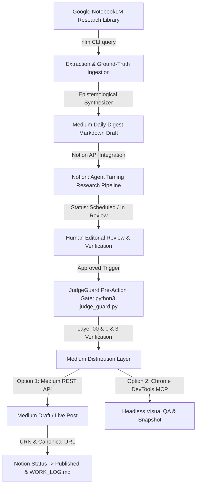

# Design: Medium Daily Digest — Automated End-to-End Publication & Verification Pipeline

## Context & Technical Approach
Autonomous AI agents that publish thought leadership and technical digests to public developer platforms (such as Medium, Substack, LinkedIn, and dev.to) must not operate as unconstrained LLM loops. Unsupervised generation introduces severe risks:
1. Hallucinated technical architecture and invalid code snippets.
2. Context window bloat and runaway token consumption.
3. Premature publishing of unverified, unreviewed, or broken drafts.
4. Security leakage of API keys, internal tokens, or draft payloads.

To resolve this, the **Medium Daily Digest Pipeline** implements an end-to-end, multi-stage architecture enforcing:
- **Zero-Simulation Law:** Grounded technical content strictly extracted from authentic Google NotebookLM research libraries via `nlm query`.
- **Epistemological Distillation:** Structured Markdown generation featuring high-fidelity architectural blueprints, code blocks, and source citations.
- **Notion Staging & Quality Gate:** Automated insertion of draft articles into the `Agent Taming Research Pipeline` database in Notion (`Platform: Medium`, `Status: Scheduled` or `In Review`) with embedded asset links.
- **JudgeGuard Pre-Action Verification Gate:** Layered verification (`judge_guard.py`) enforcing work-log traceability, security checks (no `shell=True`, no sudo/root), and project essence verification.
- **Dual-Mode Publishing Mechanism:**
  - **API Publisher:** Authenticated Medium API integration (`POST https://api.medium.com/v1/users/{{userId}}/posts`) creating drafts (`publishStatus: "draft"`) for human-in-the-loop editorial approval.
  - **Visual Verification (Chrome DevTools MCP):** Headless browser verification checking visual rendering, typography, code syntax highlighting, and responsive preview before live publication.

## Architecture Data Flow

## Proposed Changes & Components
### 1. `scripts/medium_digest_publisher.js`
A dedicated Node.js service mirroring `social_push_publisher.js` supporting:
- Querying Notion for scheduled Medium articles.
- Formatting Markdown to Medium's REST API schema (`title`, `contentFormat: "markdown"`, `content`, `tags`, `publishStatus: "draft"`).
- Direct integration with Medium API using `MEDIUM_INTEGRATION_TOKEN`.
- Fallback safe-mode: local artifact staging at `/tmp/medium_drafts/` when token is absent.

### 2. `openspec/changes/medium-daily-digest/`
- `design.md`: Technical architectural specifications.
- `tasks.md`: Granular taskboard tracking the delivery stages.

### 3. Verification Protocol
1. Pre-publication audit of digest content for factual citations.
2. Notion database schema update to include `Medium` as an approved platform option.
3. JudgeGuard execution gate pass.
4. User sign-off before any public network dispatch.
